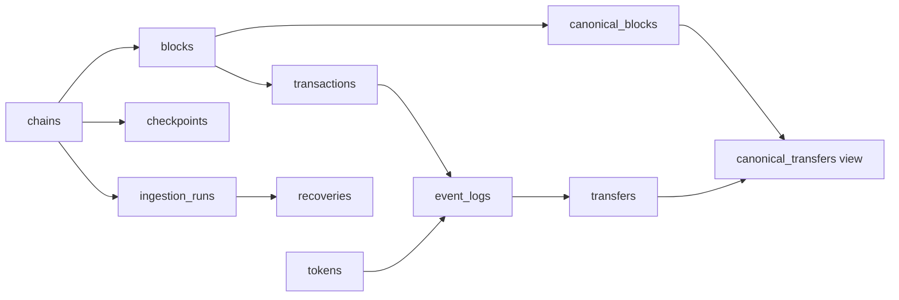

# Incremental SQL recovery showcase

This module replays recorded **synthetic** EVM-shaped fixtures into a separate
SQLite database. It demonstrates delivery/recovery mechanics, not live indexing
or a historical mainnet reorg. It never connects to a wallet, RPC, provider,
application database, or production service. Node 24.4+ is sufficient; there are
no additional dependencies or services to maintain.

```sh
npm run test:data-pipeline
npm run data:dashboard -- --out /tmp/farmgun-quality-site
# Reuse this database to demonstrate incremental/no-op reruns:
npm run data:backfill -- --db /tmp/quality.sqlite --branch original
npm run data:backfill -- --db /tmp/quality.sqlite --branch original
# Same-height recorded fork replacement:
npm run data:backfill -- --db /tmp/quality.sqlite --branch replacement
python3 -m http.server 4178 --directory /tmp/farmgun-quality-site
```

Open the HTTP server in a browser; module scripts/fetch do not work via `file:`.
The dashboard is published at <https://ethduke.github.io/farmgun-dashboard/>.
Generated report files show their generation time; they are replay snapshots,
not a continuously monitored live feed. The before/after buttons select actual
SQL snapshots produced by the worker, rather than executing a database in-browser.

## Storage and checkpoints

The additive schema is in [schema.sql](schema.sql). Use a dedicated database;
never pass the application's production database path to this CLI.



Blocks are unique by chain/hash. The canonical mapping allows one hash per
chain/height. Transactions are scoped to a block so a transaction can be
re-included on a replacement fork. Events are unique by chain/block/log index;
identical duplicate payloads are ignored, conflicting duplicates fail closed.
Token metadata and decoded transfer facts are normalized separately.

Each bounded batch commits facts and its checkpoint in the same SQL transaction.
A failed fetch or constraint does not skip its batch. Completed earlier batches
survive restarts. Empty blocks still advance coverage. Amounts remain uint256
decimal strings and totals use BigInt; no floating point or SQL integer overflow.
Totals are reconciled per asset, never summed across incompatible token units.

On a changed tip, search backward for a common ancestor within the configured
depth, atomically remove the canonical suffix, then backfill the replacement.
Orphan facts remain available for audit but are excluded from canonical views.
Unavailable replacement blocks leave an honest partial checkpoint; a later run
resumes. A source behind the stored tip and reorgs beyond the depth bound fail
closed. A missing internal canonical row triggers a rewind/backfill repair.
Changing the stream's start or token configuration requires a new database or
an explicit reviewed migration/backfill, not silent reuse of an old checkpoint.

## Recorded scenarios

The JSON fixture uses symbolic IDs; the loader expands them deterministically
into synthetic hashes/addresses locally. It contains no wallet credentials or
real identities. Original and replacement branches share ancestor 108.

| Scenario | Before | Recovery evidence |
| --- | --- | --- |
| Duplicate delivery | Every event is delivered twice | 23 canonical transfers, 23 duplicates ignored; restart/rerun writes zero blocks |
| Missing blocks | Source cannot serve block 106; checkpoint remains 105 | Restart worker and backfill six blocks through 111 |
| Recorded fork | Three stored blocks disagree with the replacement branch | Replay 109–111; retain three orphan blocks and exclude their totals |

Reconciliation independently rereads the source and compares block hashes,
parent links, transactions, event payloads, normalized projection completeness,
per-token totals, checkpoint/coverage, foreign keys, and SQL integrity. A healthy
head/checkpoint alone cannot pass these checks. Tests also exercise deep reorg
refusal, partial batch failure, corrupt projections, changed source during fetch,
transaction re-inclusion, stream configuration drift, and private-error redaction.

## CI and publication

The existing required `webview` job runs recovery tests in its network-disabled
test container and generates the aggregate dashboard. Any failed recovery or
final invariant fails that job. A 14-day artifact retains only the static site
and aggregate JSON; it excludes database files, raw fixtures, wallet addresses,
raw errors, and environment values. Existing audit policies stay enforced.

The separate `farmgun-dashboard` Pages repository serves the generated files.
To refresh it, build/test from a reviewed source revision, copy only the generated
site files into that repository, commit, and let its Pages workflow publish them.
This deliberately needs no cross-repository write token. The dashboard repository
records the source revision and includes its own aggregate validation before
publication. Do not copy databases, local environment files, or runtime logs.

## Live adapter boundary

`Pipeline.sync(source)` accepts `getHead()` and `getBlock(height)`; see
[fixture-source.mjs](src/fixture-source.mjs) for the replay implementation. A live
adapter has **not** been configured. Before adding one, choose the chain, contracts,
event decoder/filter, starting block, finality policy, and provider budget.
Validate chain ID, log/transaction membership and filter identity; normalize
hex case and quantities, bound RPC deadlines/rate-limited reads, and pin a source
view while fetching. Reconciliation against the same provider cannot prove that
the provider omitted no logs: use receipts or a second independent source for
that assurance. Persist the complete stream/filter identity with the checkpoint
before extending beyond this fixed transfer schema.

The current worker is single-writer per database; use an external worker lock
before scheduling concurrent processes. Reconciliation is bounded to 10,000
heights for this showcase; production workloads should use bounded partitions
plus retained quality runs. No automatic schema migration or finality override
is implied. Raw data and forensic repair stay local; the public export is aggregate-only.
