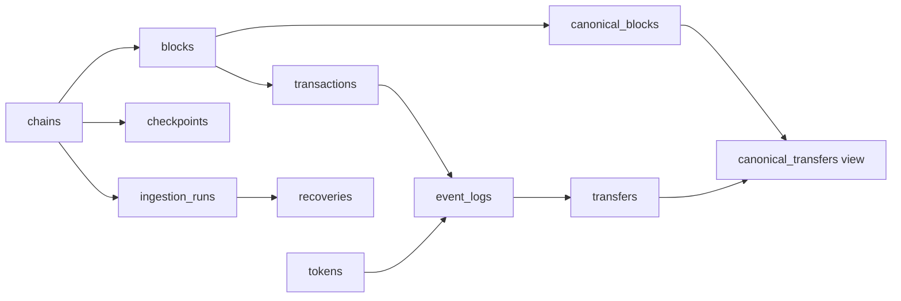

# Incremental SQL recovery showcase

The recovery demo replays recorded **synthetic** EVM-shaped fixtures into a separate
SQLite database. It demonstrates delivery/recovery mechanics, not live indexing
or a historical mainnet reorg. The replay path never connects to a wallet, RPC, provider,
application database, or production service. Node 24.4+ is sufficient; there are
no additional dependencies or services to maintain.

```sh
npm run test:data-pipeline
npm run data:dashboard -- --out /tmp/farmgun-quality-site
# Reuse this database to demonstrate incremental/no-op reruns:
npm run data:backfill -- --db /tmp/quality.sqlite --branch original
npm run data:backfill -- --db /tmp/quality.sqlite --branch original
# Same-height recorded fork replacement:
npm run data:backfill -- --db /tmp/quality.sqlite --branch replacement
python3 -m http.server 4178 --directory /tmp/farmgun-quality-site
```

Open the HTTP server in a browser; module scripts/fetch do not work via `file:`.
The dashboard is published at <https://ethduke.github.io/farmgun-dashboard/>.
Generated report files show their generation time; they are replay snapshots,
not a continuously monitored live feed. The before/after buttons select actual
SQL snapshots produced by the worker, rather than executing a database in-browser.

## Storage and checkpoints

The additive schema is in [schema.sql](schema.sql). Use a dedicated database;
never pass the application's production database path to this CLI.



Blocks are unique by chain/hash. The canonical mapping allows one hash per
chain/height. Transactions are scoped to a block so a transaction can be
re-included on a replacement fork. Events are unique by chain/block/log index;
identical duplicate payloads are ignored, conflicting duplicates fail closed.
Token metadata and decoded transfer facts are normalized separately.

Each bounded batch commits facts and its checkpoint in the same SQL transaction.
A failed fetch or constraint does not skip its batch. Completed earlier batches
survive restarts. Empty blocks still advance coverage. Amounts remain uint256
decimal strings and totals use BigInt; no floating point or SQL integer overflow.
Totals are reconciled per asset, never summed across incompatible token units.

On a changed tip, search backward for a common ancestor within the configured
depth, atomically remove the canonical suffix, then backfill the replacement.
Orphan facts remain available for audit but are excluded from canonical views.
Unavailable replacement blocks leave an honest partial checkpoint; a later run
resumes. A source behind the stored tip and reorgs beyond the depth bound fail
closed. A missing internal canonical row triggers a rewind/backfill repair.
Changing the stream's start or token configuration requires a new database or
an explicit reviewed migration/backfill, not silent reuse of an old checkpoint.

## Recorded scenarios

The JSON fixture uses symbolic IDs; the loader expands them deterministically
into synthetic hashes/addresses locally. It contains no wallet credentials or
real identities. Original and replacement branches share ancestor 108.

| Scenario | Before | Recovery evidence |
| --- | --- | --- |
| Duplicate delivery | Every event is delivered twice | 23 canonical transfers, 23 duplicates ignored; restart/rerun writes zero blocks |
| Missing blocks | Source cannot serve block 106; checkpoint remains 105 | Restart worker and backfill six blocks through 111 |
| Recorded fork | Three stored blocks disagree with the replacement branch | Replay 109–111; retain three orphan blocks and exclude their totals |

Reconciliation independently rereads the source and compares block hashes,
parent links, transactions, event payloads, normalized projection completeness,
per-token totals, checkpoint/coverage, foreign keys, and SQL integrity. A healthy
head/checkpoint alone cannot pass these checks. Tests also exercise deep reorg
refusal, partial batch failure, corrupt projections, changed source during fetch,
transaction re-inclusion, stream configuration drift, and private-error redaction.

## CI and publication

The existing required `webview` job runs recovery tests in its network-disabled
test container and generates the aggregate dashboard. Any failed recovery or
final invariant fails that job. A 14-day artifact retains only the static site
and aggregate JSON; it excludes database files, raw fixtures, wallet addresses,
raw errors, and environment values. Existing audit policies stay enforced.

The separate `farmgun-dashboard` Pages repository pins a reviewed implementation
commit in `source.json`. Its workflow checks out that exact public revision,
reruns the recovery tests in a network-disabled container, regenerates the site,
validates the aggregate-only export, and deploys only the generated directory.
It then checks the public page and exact report digest. Refresh by reviewing and
updating that source pin, then pushing or manually dispatching the Pages workflow.
This needs no cross-repository write token and copies no application database,
local environment files, or runtime logs. To restore an earlier demonstration,
revert the source pin to its previous reviewed commit and publish again.

## Live Robinhood collection (manual start)

The live CLI uses only the official keyless public Robinhood Chain RPC, chain
4663, and the canonical USDG contract from the official token registry. It records
one Transfer stream, not all chain activity or Farmgun payment records. It has no
wallet, signing methods, provider keys, production service access, or paid RPC.
Token decimals are checked against current state because the public RPC prunes
historical state; event headers and receipts still come from finalized blocks.

With Node 24.4+ in a checkout of this revision:

```sh
npm run data:collect -- --out local/robinhood-showcase
```

This boots from the most recent 15 minutes of finalized blocks, then checks new
finalized data every 15 minutes until the fixed 24-hour window is complete. It
stops afterward; an outer 26-hour deadline bounds unavailable/stale-chain waits.
The initial bootstrap means the remaining capture is approximately 23h45m plus
finality lag. Keep this process and computer awake. There is no cron, Actions
schedule, server deployment, or Codex/LLM involved in periodic checks.

To take just the initial snapshot, add `--once`. After an interruption, explicitly
resume the same session with `--resume`. An exclusive PID lock prevents concurrent
writers; a live process cannot be taken over by another CLI run. Failed batches
preserve the last verified checkpoint and are retried on the next check. A changed
finalized anchor is never silently overwritten. Public RPC congestion can delay
checks; no incomplete range is labelled complete.

Every captured block, including empty blocks, is stored. The CLI compares log
queries with complete block receipts, verifies every receipt against the header's
transaction list, deduplicates identical events, rejects conflicting events, and
recovers query omissions from the receipt stream. Event facts, verification
batches, and checkpoint changes commit atomically. This checks one provider's
internal consistency; it is not independent consensus verification.

`local/robinhood-showcase/` contains the continuing `snapshot.sqlite`, a consistent
`frozen.sqlite`, and `snapshot-report.json`. They remain local and ignored by Git.
Reports have actual capture dates and partial/complete status; an initial
15-minute capture never claims 24 hours were collected. The static export includes
counts and totals, but no database, wallet addresses, transaction hashes, keys,
provider diagnostics, or authenticated URLs. Local database size is capped at 2 GiB.

## Owner-only manual publication

Only the account `ethduke` (stable GitHub ID 2248185) may dispatch or rerun the
publisher repository's `Refresh real-chain snapshot` workflow on main. Both the
workflow guard and publication script enforce actor, triggering actor, repository,
branch, and manual event type. The static publisher never calls a chain RPC.
Administrators who change repository security/workflows can alter that policy.

To freeze and publish the latest verified local report:

```sh
npm run data:publish -- --report local/robinhood-showcase/snapshot-report.json
```

Sign in to GitHub CLI as the owner first. This sends aggregate JSON to the guarded
manual workflow; it checks the collector revision against the reviewed source pin,
commits the frozen report, and explicitly dispatches Pages (token-created commits
do not trigger push workflows). The continuing collector does not publish.
Public visitors cannot refresh or collect data through the dashboard. The separate
synthetic recovery page remains at `recovery.html` after real data is published.

The publisher's `source.json` pins the reviewed implementation. Update that pin
after merging a collector revision before starting a new session; a source pin
change during publication fails closed. To restore an older dashboard, restore
its previous source pin and aggregate report, then republish without any collection.
